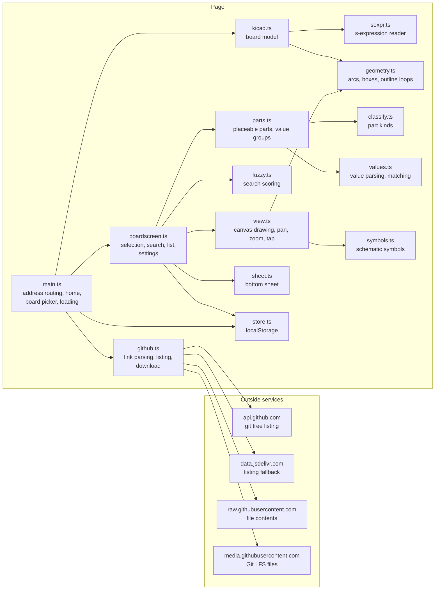

# Architecture

A static page: everything below runs in the browser. GitHub (or jsDelivr
when GitHub's API limit is used up) is the only outside service.

Data flow for one board: text -> `parseBoard` (footprints with pads, body
outline, placement and flags; Edge.Cuts loops) -> `makeParts` (kind, parsed
value, placeable) -> `buildGroups` (one group per part kind and value) ->
`BoardView` builds `Path2D` batches per side and draws; the board screen
keeps the selection, search hits and placed marks in a `ViewState` the view
reads on every frame.

Opening a board from a repository link, with rough times for a 5 MB board
on a laptop (the download depends on the network):

```mermaid
gantt
    title Opening a board (milliseconds)
    dateFormat x
    axisFormat %L
    section Network
    List the git tree (1 API call)   :list, 0, 300
    Download from raw.githubusercontent :dl, after list, 700
    section Page
    Parse the board                  :parse, after dl, 20
    Classify, read values, group     :group, after parse, 5
    Build Path2D layers              :layers, after group, 30
    First draw                       :draw, after layers, 5
```

Tests: unit tests per module in `tests/` (`bun test`); the parser is checked
against pcbnew's own numbers (`tests/truth.ts`) on committed boards in
`tests/data/` and downloaded KiCad demos in `tests/fixtures/`; the browser
checks in `tests/e2e.test.ts` drive the built site.
